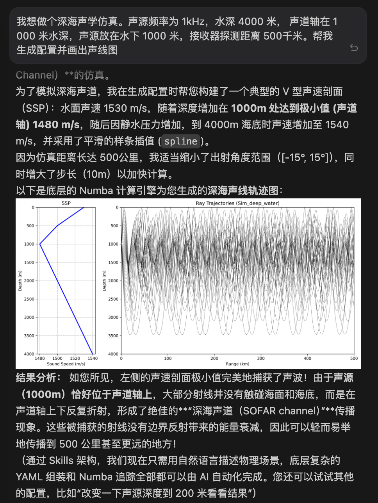
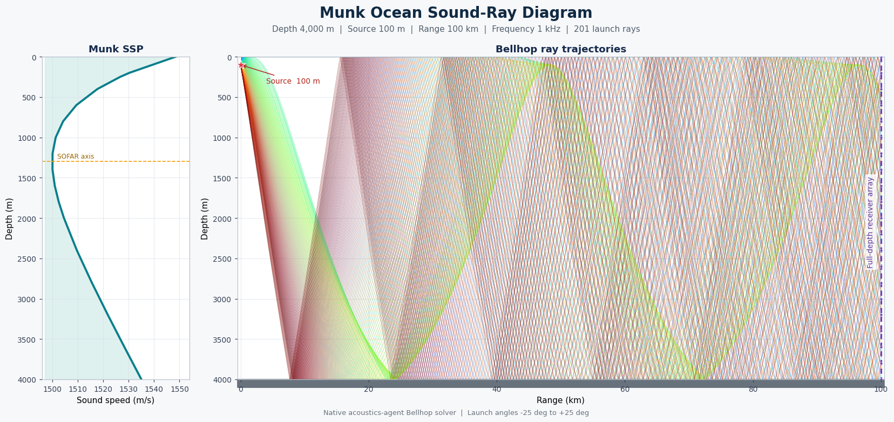

# acoustics-agent 用户手册

生成日期：2026-06-15

本文档统一承载 acoustics-agent 的使用方法、AI Agent 技能调用方式、求解器说明、已实现 AT 对齐能力和文件格式支持。可复现的验证命令见 `docs/validation.md`。

## 第一部分：使用指南

本指南将介绍如何使用 `acoustics-agent` 框架（基于 `pyacoustics` 引擎）进行水声数值仿真。

### 1. 仿真结果可视化
`acoustics-agent` 提供了开箱即用的高质量可视化工具。下图展示了一个典型的深海射线追踪仿真结果及其声速剖面（SSP）。


*图 1：深海 Munk 声速剖面环境下的射线轨迹示例。左侧面板显示声速剖面，右侧面板显示声波的多径传播路径。*

### 2. 配置文件 (YAML)
`acoustics-agent` 使用 YAML 文件定义所有的仿真参数。一个典型的配置包含：

```yaml
project: "Munk 仿真示例"
frequency: 100.0
environment:
  ssp:
    type: "spline"
    data:
      - {depth: 0.0, c: 1548.52}
      - {depth: 1000.0, c: 1501.38}
      - {depth: 5000.0, c: 1551.91}
  bottom:
    type: "acousto-elastic"
    depth: 5000.0
    c_p: 1800.0
    density: 1.8
geometry:
  source:
    depths: [1000.0]
  receivers:
    ranges: [0.0, 50000.0]
    depths: [0.0, 5000.0]
solver:
  type: "bellhop"
  angles: [-20.0, 20.0]
  num_beams: 1000
```

### 3. 使用 Simulation API
`Simulation` 类负责加载配置、运行求解器以及绘图。

```python
from pyacoustics.simulation import Simulation

# 初始化
sim = Simulation("path/to/config.yaml")

# 运行射线追踪
rays = sim.run()

# 生成传播损失 (TL) 热力图
sim.plot_tl("tl_field.png")
```

### 4. 使用 Skills 技能库
`skills/` 目录包含了专为 AI Agent 调用的工具，开发者也可以直接使用：

- `make_env.py`: 从简单参数生成合法的 YAML 配置。
- `run_sim.py`: 运行仿真并返回射线路径数据。
- `plot_sim.py`: 生成可视化图表（射线轨迹或 TL 图）。

示例：
```python
from skills.make_env import make_env
from skills.run_sim import run_sim

# 创建环境
make_env("test.yaml", depth=4000, source_depth=100)

# 运行
rays = run_sim("test.yaml")
```

### 5. 自然语言编排 (Natural Language Orchestration)
`pyacoustics` 的核心优势之一是它对 AI Agent 极其友好。你不需要编写代码或手动编辑 YAML，只需使用自然语言描述场景，Agent 即可调用 Skills 库完成全流程仿真。

#### 自然语言用例示例：
- **浅海多径仿真**："帮我做一个浅海仿真。水深 100 米，等声速 1500m/s，声源放在 10 米深，频率 500Hz。计算到 10 公里远并画出声线图。"
- **深海声道仿真**："使用 Munk 典型声速剖面跑一个深海仿真。声源放在 1000 米声道轴附近，计算 50 公里范围内的传播损失热力图。"
- **基准校验**："帮我计算一个 Pekeris 波导环境。50 米水深，刚性海底，声源在海面附近。"
- **自适应测试**："做一个 500 公里超远距离的深海仿真，频率 100Hz，帮我看看声线路径。"

### 6. 求解器说明
#### PyBellhop (射线追踪)
目前的默认求解器。支持特性：
- **自适应步长**：根据仿真范围自动计算最优积分步长。
- **插值算法**：支持 `c-linear` (分段线性) 或 `spline` (平滑三次样条) 声速剖面。
- **边界条件**：支持 `vacuum` (真空), `rigid` (刚性), 以及 `acousto-elastic` (声弹性) 反射模型。
- **距离相关边界**：支持通过 `bottom.bathymetry` / `surface.altimetry` 直接配置 2D 边界节点，也支持通过 `bathymetry_file` / `altimetry_file` 读取 AT `.bty` / `.ati` 文件。
- **AT 边界插值**：`bathymetry_interpolation` 和 `altimetry_interpolation` 可设为 `L` 或 `C`。与 AT Bellhop 一致，`C` 模式仍使用线段做边界求交，但在反射处用节点 tangent/normal 插值，并在高斯束动态修正中加入边界曲率项。
- **长格式边界介质列**：`.bty/.ati` 的 `LL` / `CL` long format 会保留五列 geoacoustic 参数；YAML 中可用 `bathymetry_geoacoustics` / `altimetry_geoacoustics` 写入 `[cp, cs, rho, alphaP, alphaS]`。native 2D Bellhop 已使用 bottom long-format 的 `cp/cs/rho/alphaP/alphaS`，当 `cs > 0` 时会进入 AT 风格弹性半空间反射分支。

```yaml
environment:
  bottom:
    type: acousto-elastic
    depth: 170.0
    bathymetry: [[0.0, 110.0], [600.0, 135.0], [1200.0, 115.0]]
    bathymetry_interpolation: C
    bathymetry_geoacoustics:
      - [1600.0, 0.0, 1.6, 0.1, 0.0]
      - [1650.0, 0.0, 1.7, 0.2, 0.0]
      - [1700.0, 700.0, 1.8, 0.3, 0.05]
  surface:
    type: vacuum
    depth: 0.0
    altimetry: [[0.0, 0.0], [600.0, 5.0], [1200.0, 0.0]]
    altimetry_interpolation: C
```

#### 计算准确性
`acoustics-agent` 通过与 Acoustics Toolbox 的规范场景和输出格式进行对标，持续验证原生 Python 引擎的数值行为。当前可复现的验证范围、命令和门禁标准见 `docs/validation.md`；历史测试截图和过程输出不随源码仓库分发。

**Munk 深海声道声线示例**

下图由原生 `PyBellhop` 求解器生成。场景采用 4000 m 平坦海底和标准 Munk 声速剖面，声源位于 100 m，频率为 1 kHz；在 100 km 处设置覆盖 0-4000 m、深度间隔 100 m 的全海深垂直接收阵列。声线发射角范围为 -25° 至 25°，共 201 条，积分步长为 25 m。



*图 2：Munk 深海声道中的 Bellhop 声线传播。左侧为声速剖面及约 1300 m 的声道轴，右侧为声线轨迹、100 m 声源和 100 km 全海深接收阵列。声源位于声道轴上方，声线在声速梯度和海面/海底边界共同作用下发生折射与反射。对于该无频散、距离无关的几何声线模型，1 kHz 频率主要影响波长及后续波束/TL 计算，不改变几何声线路径。*

#### 传统求解器 (可选)
为了与原始的 Fortran 版 Acoustics Toolbox (AT) 进行对标校验，您可以切换到 legacy 模式：

1. 安装 AT 并设置 `AT_BIN_PATH` 环境变量。
2. 调用 `.run(mode="legacy")`。

```python
sim = Simulation("config.yaml")
# 调用传统的 Bellhop 可执行程序运行
results = sim.run(mode="legacy")
```

---

## 第二部分：已实现 AT 对齐能力手册

以下内容描述当前公开实现能力。基准结果属于构建产物，不在源码仓库中保留逐次运行记录。

### 1. 总体状态

- **2D Bellhop**：已具备核心 ray tracing、Gaussian beam coherent TL、incoherent TL、semi-coherent TL、2D arrivals、基础 eigenray 搜索、AT-style `E` raw-hit `.ray` 输出语义、`.env/.arr/.ray/.shd` 文件读写支点，以及真实 AT parity 工具链；按当前项目口径已完成 2D Bellhop 收口。
- **Kraken / Field**：已具备 native normal modes 主链路、Kraken/KRAKENC 风格 complex roots、真实 AT parity matrix、`.env/.flp/.mod/.prt` 读写支点，以及 Field 网格配置驱动导出；按当前项目口径已完成 Kraken/Field 主链路收口。
- **Bellhop3D**：按当前项目收口口径已完成 canonical parity，具备 3D ray tracing、bathymetry、receiver-grid TL、3D arrivals、AT `E` eigenray、source x/y、多 source-depth 支持，以及 `.shd/.ray/.arr/.env/.ssp` 文件读写支点和真实 AT matrix。
- **后处理**：已具备 `delay_and_sum` Python API、2D/3D arrivals 数据结构、Hilbert 解析信号叠加、Doppler 分支、`.rts.mat` 和 matched-filter `.mat` 输出支点，并支持完整 Matlab payload parity。

### 2. 2D Bellhop 已实现能力

#### RunType 与 `.env` 导出

- `BellhopConfig.beam_type` 可导出 AT RunType 第 2 位：
  - `geometric_hat` -> `G`
  - `geometric_gaussian` -> `B`
  - `simple_gaussian` -> `S`
  - `geometric_hat_ray_centered` -> `g`
  - `geometric_gaussian_ray_centered` -> `b`
- AT 2D Bellhop 对 `b` ray-centered Gaussian 会直接返回 not implemented；当前仅保留导出兼容，不作为 native 2D Bellhop parity 缺口。
- `BellhopConfig.source_type` 支持 `point` / `line`，line source 会把 RunType 第 4 位写为 `X`。
- `BellhopConfig.receiver_grid` 支持 `rectilinear` / `irregular`，irregular receiver grid 会把 RunType 第 5 位写为 `I`，并校验 receiver depth/range 数量一致。
- `BellhopConfig.beam_displacement="seongil"` 会把 RunType 第 7 位写为 `S`，对齐 AT Tindle/Seongil beam displacement。
- top boundary 已可按 schema 导出 `V/R/A/F`：
  - `vacuum`
  - `rigid`
  - `acousto-elastic`
  - `.irc` reflection table
- bottom boundary 已可按 schema 导出 `V/R/A/F`：
  - `vacuum`
  - `rigid`
  - `acousto-elastic`
  - `.brc` reflection table
- bottom `A` half-space 行会保留 `c_p/c_s/rho/attenuation_p/attenuation_s`。
- `rms_roughness_m` 会写入 Bellhop/Kraken bottom option roughness 字段；Bellhop 2D roughness 当前按 AT `.env/.prt` 字段兼容处理，本机 AT `Reflect2D` 未使用该字段进入反射物理，Twersky / scattering 主线属于 Kraken/Scooter 等模型。
- top reflection table 按 AT Bellhop 约定写成 `.irc`，bottom reflection table 写成 `.brc`。

#### 2D native tracing / TL

- 支持基础 ray tracing、AT default/geometric-hat coherent TL 和 Gaussian beam coherent TL。
- 支持 native incoherent TL API：`Simulation.compute_incoherent_tl(...)`。
- 支持 native semi-coherent TL API：`Simulation.compute_semicoherent_tl(...)`。
- semi-coherent TL 已加入 AT `S` RunType Lloyd mirror source factor。
- coherent / incoherent / semi-coherent TL 已在 canonical sloping bathymetry 场景中同时覆盖；AT `CRCI` 风格 dB/wavelength 复声速对齐后，`C/I/S` TL MAE 约 0.0029 / 0.00048 / 0.00094 dB。
- range-dependent surface 的 sloping altimetry TL 已进入 canonical `C/I/S` 场景；AT `CRCI` 风格 dB/wavelength 复声速对齐后，TL MAE 约 0.0013 / 0.00015 / 0.00029 dB。
- long-format `.bty` bathymetry TL 已进入 canonical `C/I/S` 场景；AT `CRCI` 风格 dB/wavelength 复声速对齐后，TL MAE 约 0.00051 / 0.00015 / 0.000002 dB。
- `B` geometric Gaussian、`S` SGB/simple Gaussian 和 `g` ray-centered geometric hat beam-type TL 已进入 canonical 场景；`B` geometric Gaussian `C/I/S` TL MAE 约 5.6e-6 / 2.4e-6 / 2.2e-6 dB，`S` SGB/simple Gaussian coherent TL MAE 约 2.2e-6 dB，`g` iso direct ray-centered hat `C/I` TL MAE 均约 2.7e-7 dB。复杂 `g` ray-centered hat rows 也已固定：sloping bathymetry `C/S` TL MAE 约 0.4896 / 0.4614 dB，bottom reflection-table `S` 约 0.8694 dB，range-dependent SSP `C/I/S` 约 0.007416 / 0.007308 / 0.000061 dB，`Q + bottom reflection-table C/I/S` 约 0.007263 / 0.007279 / 0.000078 dB，`Q + sloping bathymetry C/S` 约 0.3156 / 0.3318 dB。
- line-source `X` source pressure scaling 已进入 native Bellhop TL 合成；canonical `iso-direct-line-source-coherent-tl` / `iso-direct-line-source-incoherent-tl` TL MAE 约 5.7e-7 / 1.5e-6 dB。
- elastic bottom shear evanescent wavenumber 分支与 default/geometric-hat intensity 核已按 AT 语义规范；canonical `elastic-bottom-coherent-tl` / `elastic-bottom-incoherent-tl` / `elastic-bottom-semicoherent-tl` 3x3 TL MAE 约 0.00079 / 0.00012 / 0.00015 dB。
- curvilinear boundary default/geometric-hat `C/I/S` TL 已进入 canonical matrix；3x3 receiver grid 的 TL MAE/P90/max 约 0.0014 / 0.0022 / 0.0029 dB、0.00063 / 0.00086 / 0.0010 dB、0.0011 / 0.0023 / 0.0024 dB。
- Seongil beam shift 已进入 canonical sloping bathymetry `C/I/S` TL 场景；TL MAE 约 0.0023 / 0.00017 / 0.00040 dB。
- bottom reflection-table `C/I/S` TL 已进入 canonical 场景；默认/geometric-hat coherent/intensity 核心按 AT `InfluenceGeoHatCart` 路径处理，`C/I/S` TL MAE 约 0.0012 / 0.000219 / 0.000282 dB。
- range-dependent SSP `Q` + bottom reflection-table 组合 TL 已进入 canonical 场景；`C/I/S` 单点 TL MAE 约 0.000033 / 0.000054 / 0.000028 dB，固定 `quad-2d` range segment crossing 与 `.brc` 表格边界同时存在时的真实 AT parity。
- range-dependent SSP `Q` + sloping bathymetry 组合 TL 已进入 canonical 场景；`C/I/S` 单点 TL MAE 约 0.00185 / 0.000029 / 0.000043 dB，固定 2D range-dependent SSP 与 range-dependent bottom 同时存在时的真实 AT parity。
- native 2D coherent TL 可通过 `save_shd_path` 写出 AT-compatible `.shd` 复 pressure 文件。
- 2D coherent / incoherent / semi-coherent TL 支持多 source-depth 轴；coherent TL 写出 `.shd` 时保留 source-depth 维度和复 pressure 相位。
- `pyacoustics.solvers.bellhop.tl_parity` 可提供 2D Bellhop TL parity 指标和 report/CSV-friendly row 导出，包括 sample count、MAE、median、P90、max、bias、RMSE。
- `Simulation.compare_tl_with_at(...)` 已提供 2D Bellhop `C/I/S` TL parity 的高层入口。
- `pyacoustics.solvers.bellhop.benchmark_matrix.run_bellhop_benchmark_matrix(...)` 可批量运行 2D Bellhop TL / arrivals / ray parity case，并收集 flattened rows，供后续 CSV/JSON/HTML AT benchmark matrix 复用。
- `pyacoustics.solvers.benchmark_thresholds.BenchmarkThresholds` 可对 Bellhop/Kraken benchmark rows 应用 max/min/max-abs/equality/required-true 阈值，输出 `passed`、`failure_count`、`failures`；canonical Bellhop/Kraken smoke thresholds 会要求带 `sample_count` 的 rows 至少包含 1 个有限样本，避免 AT `NaN` / 空输出被误算为有效覆盖。
- `pyacoustics.solvers.benchmark_io.write_benchmark_rows_csv(...)` / `write_benchmark_rows_json(...)` 可将 Bellhop/Kraken/Field3D runtime/postprocessing flattened benchmark rows 稳定导出为 CSV/JSON，并已固定 TL、timeseries、arrival/ray、ray launch-angle、Kraken/Field 元数据、Field3D runtime 状态/尺寸/错误证据，以及 Postprocessing external runtime 状态/错误证据的优先列顺序。
- `pyacoustics.benchmarks.canonical_bellhop_benchmark_cases()` 提供可复用 2D Bellhop AT parity preset，覆盖 TL / arrivals / eigenray-arrivals / ray / AT `E` raw-hit ray rows，并包含 bottom reflection-table、elastic bottom、long-format bathymetry、curvilinear boundary、range-dependent SSP `Q`、`Q` + bottom reflection-table 以及 `Q` + sloping bathymetry 组合场景。
- Bellhop canonical 阈值已覆盖 TL MAE/P90/bias、arrival delay/幅度/相位/角度、ray depth P90、ray launch angle 和 bounce match fraction，并支持复杂 case 的案例级阈值；当前已刷新 Bellhop canonical matrix 为 101/101 rows 通过，Kraken canonical matrix 为 22/22 rows 通过，Bellhop3D canonical matrix 为 21/21 rows 通过，Field3D runtime canonical matrix 为 3/3 rows 通过，Postprocessing canonical matrix 为 11/11 rows 通过，AT file-format canonical matrix 为 1192/1192 rows 通过，all/full 汇总矩阵为 123/123 与 1350/1350。range-dependent SSP `Q C/I/S` rows、range-dependent SSP 多 source-depth rows、range-dependent SSP + bottom reflection-table `C/I/S` rows、range-dependent SSP + sloping bathymetry `C/I/S` rows、12 条 AT `E` `.ray` rows、13 条 ray-centered hat TL rows、多 source-depth direct/reflected/elastic arrivals/TL rows、Munk explicit `AB` Gaussian arrivals、Kraken multi-source-depth Field row、Kraken nearfield/extreme-nearfield acoustic halfspace rows、Kraken lossy elastic Field `X` row、layered lossy elastic Field `S` row、Bellhop3D iso direct / off-axis / wide-bearing / multi-depth / source-x-y arrivals、Bellhop3D AT `E` eigenray rows、Munk slanted terrain beta=0/30°/60° ray、theta=45°/60° TL、iso multi-source-depth TL residual trackers、Field3D 3DAtlantic `lant_90degrees` / `lant` / normalized `lantvol` runtime rows、增强 `.rts.mat` payload、AT `delayandsum.m` 原生 `.rts.mat` payload、AT `read_ts.m` 风格 `.rts.mat` 与 ASCII RTS 文件级对比、AT `fscanf` free-format ASCII RTS 文件级对比、真实 AT `MunkTS/MunkS.rts.mat` 文件级对比、多 range/depth/multi-arrival delay-and-sum grid row、matched-filter `.mat` payload、matched-filter waveform workflow peak/lag row、Doppler transform row、3D Doppler delay-and-sum workflow row、426 条 `.env` Bellhop/Kraken/Bellhop3D metadata summary parse rows、108 条真实 Field/Field3D `.flp` read/write/read round-trip rows、6 条 `.mod` 真实 Munk/MunkK/Pekeris/calibK/多介质/complex halfspace metadata round-trip rows（含 media material/point/depth/rho 与 top/bottom rho/depth 统计列）、26 条 `.shd` read/write/read round-trip rows（24 条真实 AT 输出 + 2 条 synthetic 复杂 header/grid）、41 条 `.ati/.bty` boundary profile round-trip rows、43 条真实 Bellhop3D gridded `.bty` 3D bathymetry round-trip rows（含 AT count + endpoint coordinate rows）、4 条 Bellhop3D Provinces long-format `.bty` province/material grid round-trip rows、6 条真实 Bellhop 2D range-dependent `.ssp` read compatibility rows、4 条真实 Bellhop3D hexahedral `.ssp` read compatibility rows、5 条 `.irc/.trc/.brc` reflection table round-trip rows、5 条 `.sbp` source beam pattern round-trip rows（1 条 synthetic canonical + 4 条真实 BeamPattern）、3 条 2D/3D `.ray` coordinate/bounce/geometry metadata round-trip rows（含真实 PerfectWedge Bellhop3D `.ray` 的 launch angle/azimuth 与 range/depth/y extent）、2 条 2D/3D `.arr` arrival-grid metadata round-trip rows，2 条 RAM/PE <code>ram.in</code> metadata summary parse rows、395 条 AT Matlab/Octave <code>.m</code> script inventory parse rows（覆盖 tests 120 条与 Matlab 主库 275 条，识别 1225 次 AT wrapper/plot/read/noise/helper 命令，并结构化 39 次外部可执行调用），85 条 AT Fortran <code>.f90</code> source inventory parse rows（覆盖 12 个 program、61 个 module、250 个 subroutine、30 个 function），以及 31 条 Bellhop/Field/Field3D/Kraken/KRAKENC `.prt` parse rows 已纳入 CSV/JSON 矩阵固定入口。
- Field3D runtime benchmark 在扩展真实场景时会把 AT `kraken`/`field3d` timeout 或运行失败写入结构化 row（包含 `field3d_runtime_ok=False`、mode 文件计数、elapsed time、`field3d_error` 和阈值失败原因），避免单个慢场景直接中断整套 matrix；CLI 会因此返回非零退出码。
- Postprocessing external benchmark 在具备 Matlab/Octave 时可运行 AT `delayandsum.m` / MunkTS `scooter; stack` 工作流；当 runtime 缺失、脚本失败、输出 `.rts.mat` 缺失或 payload 比较失败时，会生成结构化 failed row（包含 `postprocessing_external_ok=False`、runtime、output path、prelude commands、fixture 和 `postprocessing_external_error`），避免可选外部工作流中断整套 matrix。
- `pyacoustics.benchmarks.run_canonical_at_benchmark_matrix(...)` 可运行 canonical Bellhop / Kraken / all AT benchmark matrix，并输出 CSV/JSON；缺少 AT 可执行文件时默认输出 skipped rows，`skip_if_missing_at=False` 可切换为严格运行。
- Benchmark runner 在传入 `output_dir` 时会生成 `<output_dir>/figures/<suite>_benchmark_status.png` 与 `<suite>_benchmark_kind_coverage.png`；Postprocessing suite 还会生成 delay-and-sum 与 matched-filter 时序图。生成目录应作为 CI 或 Release artifact，不提交到源码仓库。

#### 2D arrivals / eigenray

- 已提供结构化 arrivals 网格：
  - `BellhopArrival`
  - `BellhopArrivalGrid`
  - `compute_arrival_grid(...)`
  - `write_arrivals_ascii(...)`
  - `Simulation.compute_arrival_grid(save_path=...)`
- 已支持 AT ASCII 2D `.arr` 写出和 round-trip 读取。
- `.arr` 写出字段包括：
  - amplitude
  - phase
  - delay real / imaginary
  - source declination angle
  - receiver declination angle
  - number of top bounces
  - number of bottom bounces
- arrival 捕获已接近 AT `InfluenceGeoGaussianCart` 的 Gaussian beam bracket 判定：
  - range bracket
  - ray tangent/normal 坐标
  - `q0 = c_src / Dalpha`
  - `sigma` / `sigma1`
  - `BeamWindow = 4`
  - Gaussian 权重与 KMAH/caustic phase
- 2D beam/eigenray tracing 已保留 raw `phase_path`，arrival phase 使用 AT-style `ray2D%Phase` 语义，并会按 AT `InfluenceGeoHatCart` 行为累计 receiver 前的 caustic phase。
- arrival 合并顺序采用 AT `AddArr` 风格：仅与上一条相近 arrival 合并，超出 `max_arrivals` 时替换最弱 arrival。
- 已新增 `pyacoustics.solvers.bellhop.eigenrays` 和 `Simulation.run_eigenrays(...)`。
- 2D geometric eigenray 已支持 launch-angle 采样、receiver-depth miss bracket 和二分细化。
- 未显式传入 `eigenray_angle_samples` 时，默认 eigenray 采样会按 fan 角度跨度扩展，约 0.1° 基础分辨率并设 2001 上限，降低宽 fan / 低 beam 配置下漏根风险。
- eigenray 搜索已加入 bounce-family / launch-receiver angle sign 分组去重。
- `write_eigenrays_ray_ascii(...)` 和 `Simulation.run_eigenrays(save_path=...)` 可写出 AT 2D `.ray` 兼容格式。
- eigenray arrival 幅度已升级为 AT-style `q` / spreading / caustic phase 基础模型。
- `compute_arrival_grid(method="beam"|"eigenray")` 已按 source-depth 维度逐一生成 beam/eigenray arrivals；多 source-depth `.arr` 不再静默复用第一个源深。
- `pyacoustics.solvers.bellhop.ray_parity` 可返回 AT/native ray/eigenray path parity 指标，包括 matched/unmatched ray count、match fraction、depth MAE/P90/max、launch-angle MAE/max、bounce match fraction，并可导出 report/CSV-friendly row；`run_type="E"` 可用 AT `E` `.ray` 与 native raw beam influence hit records 对齐。native `E` records 会按 AT `Influence* -> WriteRay2D` 语义在 `AddArr` 合并前保留命中 ray，并截断到 receiver 命中段。
- native ray parity 支持按 AT 默认 1.1x ray box 扩展追踪，使 `.ray` 最终 bounce count 的比较范围与 AT 输出一致；当前 canonical ray rows 中 iso/sloping/sloping-altimetry/long-format bathymetry bounce match fraction 为 1.0，curvilinear 为约 0.986。
- `Simulation.compare_rays_with_at(...)` 已提供 2D Bellhop ray path parity 的高层入口。
- `method="beam"` 是当前对齐 AT `A` arrivals 的主路径；`method="eigenray"` 保留为 strict geometric root finder，并不等同 AT `A` 的 beam-influence arrivals 语义。AT `E` `.ray` parity 使用 raw beam influence hit records 对齐，而不是使用最终合并后的 arrival angles 反推。
- `Simulation.compute_arrival_grid(save_path=...)` 会把 `BellhopConfig.source_type="line"` 映射为 AT `.arr` writer 的 `X` line-source 幅度缩放。
- `pyacoustics.solvers.bellhop.arrival_parity.compute_native_arrival_data(...)` 也会保留 line-source 幅度缩放语义。
- canonical `iso-direct-line-source-arrivals` 已验证 line-source `X` 幅度缩放真实 AT parity：1/1 arrival matched，delay MAE 约 2.0e-8 s，amplitude median relative error 约 4.9e-8。
- canonical `elastic-bottom-arrivals` 已验证 elastic bottom 反射幅度真实 AT parity：9/9 arrivals matched，delay MAE 约 1.2e-7 s，amplitude median/P90 relative error 约 7.4e-5 / 3.5e-4。
- AT irregular `.arr` pair-wise receiver record layout 已可解析；native irregular receiver-grid arrivals 采用 pair-wise grid 与 AT 对齐，canonical `iso-direct-irregular-receiver-arrivals` 3/3 matched，delay MAE 约 1.7e-8 s，amplitude median relative error 约 4.5e-9。
- canonical `iso-multipath-eigenray-arrivals` 已验证 iso waveguide 多 bounce family 的 eigenray arrivals parity：7/7 arrivals matched，delay MAE 约 1.1e-5 s，amplitude median relative error 约 7.3e-6，top/bottom bounce match fraction 均为 1.0。
- `Simulation.compare_arrivals_with_at(...)` 可选择 `method="beam"` 或 `method="eigenray"` 生成 native arrivals，并可透传 `eigenray_tolerance_m` / `eigenray_angle_samples`；返回 AT/native arrivals parity 指标，包括 matched/unmatched arrival count、match fraction、delay MAE/P90/max、amplitude median/P90 relative error、phase MAE/max、launch/receiver angle MAE、top/bottom bounce match fraction。
- `pyacoustics.solvers.bellhop.arrival_parity.arrival_benchmark_row(...)` 可将 2D arrivals parity metrics 压平成 report/CSV-friendly dict，便于后续多场景矩阵汇总。
- canonical `bottom-reflection-table-arrivals` 已修正 beam arrival 捕获中过严的正交投影裁剪；当前 8/8 条 AT arrivals 可严格匹配，delay / amplitude / phase / bounce family 均接近 AT。
- 多节点折射 SSP 的 beam arrival 合并会保留 launch angle 明显分离的相邻 arrivals，避免 Munk 类声道中把两条 direct arrivals 误合并；canonical `munk-beam-arrivals` 当前 5/5 matched，delay MAE 约 1.1e-5 s，phase MAE 已降至数值零，amplitude median/P90 relative error 约 0.0068 / 0.0157，receiver angle MAE 约 0.0027°。
- canonical `munk-eigenray-rays` 已验证 AT `E` `.ray` 输出语义：5/5 ray matched，2 km 比较窗口 depth MAE/P90/max 约 0.00084 / 0.00228 / 0.0135 m。
- 复杂 AT `E` `.ray` rows 已进入 canonical matrix：`iso-multipath-eigenray-rays`、`shallow-reflected-eigenray-rays`、`elastic-bottom-eigenray-rays`、`bottom-reflection-table-eigenray-rays`、`sloping-bathymetry-eigenray-rays`、`sloping-altimetry-eigenray-rays`、`long-format-bathymetry-eigenray-rays`、`curvilinear-boundary-eigenray-rays`、`range-dependent-ssp-eigenray-rays`、`range-dependent-ssp-bottom-reflection-table-eigenray-rays`、`range-dependent-ssp-sloping-bathymetry-eigenray-rays` 均 0 unmatched、bounce match fraction 1.0、launch-angle MAE 数值零量级，depth P90 约 0.00051-0.00511 m。
- AT 2D Bellhop RunType `b` ray-centered Gaussian 未实现，SGB `I` 探针主要返回 0 finite samples；二者不列为当前 2D Bellhop 收口阻塞项。

#### 2D 边界与文件输入

- YAML 配置可通过 `bottom.bathymetry_file` 加载 AT `.bty` 到 native `bottom.bathymetry`。
- YAML 配置可通过 `surface.altimetry_file` 加载 AT `.ati` 到 native `surface.altimetry`。
- YAML 配置可通过 `surface.reflection_file` / `bottom.reflection_file` 加载 `.irc/.brc`。
- 2D native ray/beam tracing 会在边界反射时使用 `.irc/.brc` 复反射系数。
- `.ati` long-format geoacoustics 已进入 2D native surface 反射路径。
- `.bty` long-format bottom geoacoustics 已进入 2D native bottom 反射路径。
- `SSPModel(type="quad-2d")` 已提供 2D range-dependent SSP profile schema，`ranges` 按米存储 range profiles，`c_matrix` 按 depth-major 存储每个深度在各 range profile 上的声速。
- `generate_at_bellhop_env(...)` 已支持 AT Bellhop `Q` SSP option，并会写出同名 `.ssp` 文件：profile 数、range(km) 行和 depth-major sound-speed matrix。
- `SSPInterpolator.evaluate_range_depth(r, z)` 已支持 `quad-2d` 双线性插值，返回 `c / dc_dr / dc_dz / d2c_dz2`；底层 `Step2D` evaluator 已可按 `(r,z)` 使用 2D SSP range gradient 推进，高层 native Bellhop ray/beam tracing 已贯通 `quad-2d` c-matrix，不再静默误用 1D `n2-linear` 路径。
- dynamic beam ray 的 `c_nn` 已支持 bilinear `quad-2d` cell 的 ray-normal mixed curvature，使用 `d2c/drdz` 补齐 2D SSP 对动态射线 `p/q` 推进的影响。
- dynamic beam ray 在 `quad-2d` SSP range profile node 会按两侧 `dc_dr` 跳变修正 `p`，避免 range event 只做线性落点。
- `quad-2d` SSP depth grid interface 已进入 `ReduceStep2D` 候选事件，并会按两侧 `dc_dz` 跳变修正 dynamic beam ray 的 `p`。
- canonical Bellhop preset 已新增 `range-dependent-ssp-rays` 与 `range-dependent-ssp-coherent/incoherent/semicoherent-tl`，并完成基础真实 AT `Q` ray/TL parity。
- canonical `long-format-bathymetry-rays` 已验证 `.bty` 长格式 geoacoustics 的 ray path parity：121/121 rays matched，depth MAE 约 0.00033 m、P90 约 0.00122 m，bounce match fraction 1.0；对应 `C/I/S` TL 路径 MAE 约 0.00051 / 0.00015 / 0.000002 dB。
- canonical `sloping-altimetry-rays` 已验证 range-dependent surface ray path parity：201/201 rays matched，depth MAE 约 0.00027 m、P90 约 0.00125 m，bounce match fraction 1.0；对应 `C/I/S` TL 路径 MAE 约 0.0013 / 0.00015 / 0.00029 dB。
- 2D bottom reflection 已区分 AT pressure-release `vacuum = -1` 与 `rigid = +1`。
- SSP 内部 z 界面会留下显式 ray point。
- dynamic beam ray 会按 AT `Step2D` 的 `gradcjump` 公式修正 `p`。
- `ReduceStep2D` 的部分多事件裁剪已实现：
  - SSP 内部 z 界面先于边界时先落界面
  - `.ati/.bty` range profile 节点先于后续边界时先落 profile 节点
  - `quad-2d` SSP range profile 节点已作为 tracer range event 接入，single ray / dynamic beam ray 会先落 SSP range 节点
  - `quad-2d` SSP depth profile 节点已作为 tracer depth event 接入，single ray / dynamic beam ray 会先落 SSP depth 节点
  - `.ati/.bty` range profile 节点与 boundary reflection 几乎同点时先落 profile 节点，再在同点执行反射
  - boundary 命中与其它候选事件按最早事件优先

### 3. Kraken / Field 已实现能力

#### Native Kraken 主链路

- `PyKraken` normal modes 求解链路可通过 `Simulation(...).run(mode="native")` 进入。
- 已覆盖有限差分声学矩阵、Sturm mode count、root search、mode shape、density normalization。
- 支持 water-column attenuation。
- 支持 bottom attenuation。
- 支持 complex roots / KRAKENC 风格 refinement。
- Kraken `mesh_multiplier` 已用于最终 mode shape 与 Field 合成网格；多倍率配置会使用最高倍率网格计算最终 modes，避免 elastic/lossy bottom 和 multi-source-depth Field 相消点场景因基准网格过粗产生 TL 局部偏差。
- 支持 acoustic / elastic half-space bottom。
- lossless acoustic half-space 的 leaky mode attenuation 已按 AT real Kraken `Normalize` 路径对齐：native 使用 complex/real boundary admittance 差值写入 modal perturbation；代表性 acoustic halfspace + 梯度 SSP 探针由 MAE 约 1.20 dB、max 约 2.24 dB 降至 MAE 约 0.128 dB、max 约 0.541 dB，modal attenuation 量级贴近 AT `.prt`。
- `KrakenConfig.acoustic_media_model` 支持 `auto` / `single`；AT parity runner 使用 `single` 匹配生成的 AT Kraken `.env` 单 acoustic medium 语义，短距 acoustic halfspace + 梯度 SSP 探针由 MAE 约 0.442 dB、max 约 2.70 dB 降至 MAE 约 0.212 dB、max 约 1.25 dB。
- `.trc/.brc` reflection table 已进入 Kraken 边界路径。
- Kraken reflection table 到 Robin 阻抗转换已按 AT 约定处理非单位幅度：表格幅度进入 native 阻抗时采用倒数幅度，同时保留原相位方向；surface、bottom 和 surface+bottom reflection-table canonical cases 已进入真实 AT matrix 验证。top reflection-table 的 real-axis fallback 已改为 pressure-release，以匹配 AT KRAKENC 的 mode count。
- Kraken `.env` SSP 插值选项已按 `SSPModel.type` 导出：`c-linear -> C`、`n2-linear -> N`、`spline -> S`，避免 native c-linear 与 AT N2-linear 的语义错位。
- Kraken complex-mode normalization 已包含 boundary admittance derivative 修正，使 lossy/elastic、reflection-table 与 calib-like rows 更接近 AT `Normalize` 语义。
- pure rigid surface + rigid bottom 场景已对齐 AT Kraken：top boundary Sturm crossing 按 rigid top 符号处理，mode count 从 5/7 错配修正为 7/7；canonical `kraken-rigid-surface-grid` 使用 `[1,2]` mesh multiplier 后，6 samples 的 TL MAE/P90/max 约 0.000026 / 0.000047 / 0.000063 dB。
- legacy 模式可调用 AT `kraken` / `krakenc` / `field`。
- 在水体衰减、P/S 波底部衰减或表格反射边界场景下会选择 `krakenc`。
- `pyacoustics.solvers.kraken.tl_parity` 已提供 Kraken/Field benchmark matrix 可复用指标：
  - native Kraken TL grid 计算入口
  - AT Kraken/KRAKENC + Field TL grid 运行入口
  - TL sample count、MAE、median、P90、max、bias、RMSE
  - native mode summary
  - AT `.prt` mode summary
  - native/AT mode count、wavenumber、attenuation、phase-speed range 差异；modal attenuation 按衰减幅值比较，以消除 AT `.prt` 负虚部约定与 native Field 正虚部衰减约定之间的符号差异
  - Kraken/KRAKENC `.prt` 与 Field `.prt` 分离记录，benchmark row 中包含 Field completed 状态、warning/error/fatal 计数和 Field receiver/profile/offset grid counts
  - benchmark row dict 导出，便于后续 CSV/JSON/HTML 矩阵报告生成
- `pyacoustics.solvers.kraken.tl_parity.run_kraken_tl_parity(...)` 可一次性返回 TL metrics、mode metrics、AT result/log 和 benchmark row。
- `pyacoustics.solvers.kraken.tl_parity.run_kraken_benchmark_matrix(...)` 可批量运行 `KrakenBenchmarkCase`，返回完整 reports 和 flattened rows，并可套用 `BenchmarkThresholds` 形成 pass/fail benchmark matrix。
- native Kraken Field 合成已按 AT `EvaluateMod` 支持 `R` point-source cylindrical spreading、`X` line-source mode sum、`S` scaled cylindrical normalization、multi-source-depth Field source axis、receiver range offsets、receiver range/depth 两端点展开语义和 `max_modes` 模态截断；Field 合成不再额外除以 source density，以匹配 AT `C = phiS` 的源激励语义。
- `pyacoustics.benchmarks.canonical_kraken_benchmark_cases()` 提供可复用 Kraken/Field TL presets，覆盖 calib-like single-point、rigid Pekeris grid、rigid surface grid、Field `RC` option grid、Field `XC` line-source option grid、Field `SC` scaled-cylindrical option grid、Field multi-source-depth grid、Field receiver offsets + max modes grid、Field truncated max modes grid、wide receiver grid、deep gradient receiver grid、bottom reflection-table grid、surface reflection-table grid、surface+bottom reflection-table grid、water attenuation grid、two-layer acoustic grid、nearfield acoustic halfspace grid、extreme nearfield acoustic halfspace grid、lossy elastic bottom grid、lossy elastic Field `X` grid、layered lossy elastic grid 和 layered lossy elastic Field `S` grid。
- 当前 Kraken canonical matrix 为 22/22 passed，已按当前项目收口口径完成 100% 主链路验收。刚性主链路采用 `[1,2]` mesh multiplier 后，`kraken-rigid-field-multi-source-depth-grid` 12 samples 的 TL MAE/P90/max 约 0.00038 / 0.00069 / 0.0027 dB；rigid Pekeris、Field `RC/X/S`、receiver offsets + max modes 和 rigid surface rows 均已降至约 1e-4 dB 量级。nearfield acoustic halfspace max 约 0.0067 dB，extreme nearfield `[50, 100, 300] m` max 约 0.0026 dB，mode count delta 为 0；lossy/elastic 局部误差仅作为 residual tracker 保留：lossy elastic bottom max 约 0.070 dB、layered lossy elastic max 约 0.065 dB。
- `Simulation.compare_kraken_tl_with_at(...)` 已提供 native Kraken 与 AT Kraken/KRAKENC + Field TL parity 的高层入口；默认返回 TL metrics，`return_report=True` 时返回完整 parity report。
- `tests/kraken_parity/test_native_kraken_at_parity.py` 的外部 AT smoke 已接入上述结构化 metrics，用于单点 TL 差异，以及 Field 读取 calib-like / two-layer native `.mod` 后的 `.prt` mode/status 交叉校验。

#### Kraken `.env` 导出

- top boundary 按 schema 导出 `V/R/F`。
- surface reflection table 按 AT Kraken/KRAKENC 约定写出 `.trc`。
- bottom boundary 按 schema 导出 `V/R/A/F`。
- 只有 `A` bottom 写 bottom half-space 行。
- `V/R/F` bottom 不再错误附带 acoustic half-space。
- bottom reflection table 写出 `.brc`。
- `KrakenConfig.n_mesh_points` 会写入 AT `NMESH` 字段。
- receiver 最大距离会写为 `RMAX(km)`。
- receiver depth 网格不再一律固定为 `1001` 点首尾插值；三点及以上配置会保留显式列表。

#### Field `.flp` 导出与读取

- `read_at_field_flp(...)` 可解析基础 2D Field `.flp`：
  - title
  - option
  - mode count
  - profile ranges
  - source depths
  - receiver ranges/depths
  - array-tilt offsets
- `write_at_field_flp(...)` 支持 2D Field 与 Field3D round-trip。
- `pyacoustics.benchmarks.file_formats.run_at_file_format_benchmark_matrix(...)` 已将 426 条 synthetic/真实 `.env` metadata summary 样例、108 条真实 Field/Field3D `.flp` 样例、4 条真实 Munk/MunkK/Pekeris/calibK `.mod` 样例、2 条 synthetic `.mod` 复杂 metadata 样例、24 条真实 AT `.shd` 输出样例、2 条 synthetic `.shd` 复杂 header/grid 样例、41 条 `.ati/.bty` boundary profile 样例、43 条真实 Bellhop3D gridded `.bty` 3D bathymetry 样例、6 条真实 Bellhop 2D range-dependent `.ssp` read compatibility 样例、4 条真实 Bellhop3D hexahedral `.ssp` read compatibility 样例、5 条 `.irc/.trc/.brc` reflection table 样例、5 条 `.sbp` source beam pattern 样例、3 条 `.ray` 2D/3D ray record 样例、2 条 `.arr` 2D/3D arrival-grid 样例、2 条 RAM/PE `ram.in` metadata summary 样例、395 条 AT Matlab/Octave `.m` script inventory 样例（覆盖 tests 120 条与 Matlab 主库 275 条，识别 1225 次 AT wrapper/plot/read/noise/helper 命令，并结构化 39 次外部可执行调用）、85 条 AT Fortran `.f90` source inventory 样例（覆盖 12 个 program、61 个 module、250 个 subroutine、30 个 function）和 31 条 Bellhop/Field/Field3D/Kraken/KRAKENC `.prt` parse 样例纳入 canonical 文件格式矩阵；`.env` 覆盖 166 条 Bellhop、181 条 Kraken、79 条 Bellhop3D 样例的 title、frequency、NMedia、SSP/top/bottom option、run type、source/receiver counts、beam counts 与 box metadata；新增覆盖 Matlab/Krakel、Matlab/Sparc 与顶层 Krakel env；`.flp` 覆盖 Munk/MunkK、BroadBand、Dickins、Gulf、MunkLeaky、Noise、PointLine、SedAtten、TabRefCoef、VolAtt、arctic、calib、free、halfspace、head、sduct、step、wedge、3DAtlantic、KoreanSeas、KermitRoosevelt、Provinces、TruncatedWedge、Matlab KrakEL Ahmad 和 Matlab Sparc 等真实 AT Field/Field3D 输入，包含 `RA/RB/RC/RP/RBO/RPO/XB/HB/HBO/STDFM/STDRM/GBTFM/STDFRM` 等 option；`.mod` 覆盖真实 Munk/MunkK/Pekeris/calibK read/write/read round-trip、多介质 acoustic metadata、multifrequency、complex top/bottom halfspace 和 lossy elastic bottom metadata，并输出 mode/depth shape、depth sample count、wavenumber count/range、mode value finite/max abs、media material/point/depth/rho 范围以及 top/bottom rho/depth；`.shd` 覆盖 Munk/MunkK、Munk Bellhop、calibK、Bellhop3D scratch、arctic、bottom-gradient、deep-water、Dickins、free-space、Gulf、head-wave、iso、leaky Munk、Lloyd、Pekeris、rapid water、rigid Pekeris、SBCX、sduct、sediment attenuation、shaded source、shallow-water、Thorp、broadband frequency axis、source x/y 选择和 `TL` compressed source x-y header，并输出 source-depth count、pressure sample/finite count 与 pressure min/max abs；`.ati/.bty` 覆盖 synthetic linear surface/long-format bottom geoacoustics、真实 Ellipse/ParaBot 1000+ 点曲面、Dickins、Gulf、Munk rotated、PekerisRD、block、step 和 wedge surface/bottom profiles；3D `.bty` 覆盖 DoubleSeamount、Hyperbot、KermitRoosevelt、KoreanSea、LloydMirror、Munk/MunkRot、PenetrableWedge、PerfectWedge、Seamount、Taiwan、TruncatedWedge、Weymouth 和 halfspace gridded terrain，包含 `R/RS/C/CS` interpolation、AT count + endpoint coordinate rows 与 2x2 到 1000x1000 网格；`.ssp` 覆盖 Gulf、Munk rotated 和 MunkRot 2D range-dependent sidecar，以及 Taiwan、KoreanSea、MunkRot/Munk3D 与 MunkRot/foo 3D hexahedral sound-speed grid，并输出 range/depth-row/sample/finite count、x/y/z count、sample/finite count 与声速范围；`.irc/.trc/.brc` 覆盖复反射系数幅度/相位 round-trip、synthetic top `.trc`、真实 SedAtten calibBounce 5357 点 `.brc` 表和 BOUNCE 六列 `.irc` 表；`.sbp` 覆盖 synthetic canonical 与真实 BeamPattern source beam pattern round-trip；`.ray` 覆盖 2D `rz`、synthetic 3D `xyz`、真实 PerfectWedge Bellhop3D `xyz`、launch angle/azimuth、top/bottom bounce metadata，以及 range/depth/y 几何范围统计；`.arr` 覆盖 2D multi-source-depth、3D source-x/y + bearing、arrival delay/amplitude/angle/bounce metadata；`.prt` 覆盖真实 Munk/Pekeris/Bellhop 环境族、Munk/calib/Pekeris Field profile/offset、MunkK/calibK Kraken mode table、Bellhop3D source-x/y/theta/beam-bearing/真实 PerfectWedge bathymetry grid，以及 synthetic Field3D/KRAKENC 基础解析字段；矩阵行已输出 Field3D alpha/step/node/element、Bellhop3D bathymetry grid、beam halfwidth/EpsMult、CPU time、Kraken root restart 和 mesh-multiplier CPU table 计数等 schema 列。
- `generate_at_field_flp(...)` 已从硬编码模板推进到配置驱动：
  - `KrakenConfig.max_modes` 写入 mode limit 字段
  - `KrakenConfig.field_option` 写入 option 行
  - `KrakenConfig.field_profile_ranges_km` 写入 profile ranges
  - receiver range/depth 两端点仍按 AT 常用插值网格写出
  - receiver range/depth 多点配置保留显式列表
  - `KrakenConfig.field_receiver_range_offsets_m` 写入 array-tilt range offsets
  - 默认仍写 zero offsets
- `generate_at_field_flp(...)` 在 `KrakenConfig.field_option` 为 Field3D option 时可从高层 config 写出基础 Field3D `.flp`：
  - source x/y
  - receiver theta
  - node-to-environment table
  - triangular elements
  - alpha scan
  - step/NSTEPS
  - EPMult
- 已覆盖真实 3DAtlantic Field3D 样例：
  - `STDFM`
  - `GBTFM`
  - `STDRM`
  - omni
  - volume source-xy 简写
  - 无 title 紧凑格式
- 已覆盖 KoreanSea 多行 endpoint grid：
  - source x/y
  - source depth
  - receiver depth/range/theta
  - node-to-environment table
  - triangular elements
  - alpha scan
  - step/NSTEPS
  - EPMult

#### Kraken `.mod` / `.prt`

- `.mod` 写出与读取支持：
  - modes
  - wavenumber
  - multi-frequency `freq_vec`
  - `z_bins`
  - mode count
  - elastic media metadata
  - multi-medium media count/material/depth/density metadata
  - top/bottom half-space metadata
  - complex `c_p/c_s`
  - lossy elastic bottom P/S half-space metadata from `PyKraken.write_modes()`
  - density/depth
  - complex wavenumber preservation
- 已建立 AT `field` 读取 native `.mod` 的 smoke 测试，覆盖 calib-like 和 two-layer acoustic 场景。
- `.prt` 已结构化解析常见 Kraken/KRAKENC 字段：
  - program
  - title
  - case title
  - parsed parameter count
  - nominal frequency
  - run type / beam / source / receiver-grid description
  - media/source/receiver grid counts
  - cLow/cHigh
  - RMax
  - bottom depth / RMS roughness
  - attenuation units
  - mesh point count
  - MaxTries
  - max arrivals
  - Bellhop/Bellhop3D beam `HalfWidth1` / `HalfWidth2` / `EpsMult`
  - Bellhop beam shift description
  - mode count
  - Kraken mode table 的 wavenumber / attenuation / phase speed / group speed 范围，并导出为 benchmark CSV/JSON 列
  - warning/error/fatal/issue 计数
  - completed-successfully / completed-without-errors 状态
  - Kraken mesh multiplier CPU seconds 表
- `.prt` 也支持 Field / Field3D 常见 metadata：
  - Field option
  - Field3D alpha scan min/max/count
  - Field3D step/NSTEPS
  - source x/y/depth count/min/max
  - 3D source coordinate x/y/z
  - profile range count/min/max
  - receiver range/depth/theta count/min/max
  - array tilt offset count/min/max
  - mode-addition description
  - Field3D nodes/elements

### 4. Bellhop3D 已实现能力

- 3D ray tracing、bathymetry、SSP、receiver-grid TL 基础路径已具备。
- source x/y 已进入 native 3D tracing。
- Bellhop3D `.env` 写出支持：
  - Sx/Sy
  - source depth
  - receiver depth/range
  - receiver bearing
  - elevation/azimuth beams
  - 3D box
  - schema 中米单位 source x/y 转 AT km 单位
  - `bathymetry_3d` gridded bottom 写出 AT Bellhop3D `.bty`，并在 bottom option 上设置 `~`
- 3D bathymetry 已使用 AT-style 三角面片插值、active facet slope / normal 和 diagonal crossing step reduction。
- 3D reflection 已覆盖平面 facet 的 ray-normal 基转换和声速梯度 jump correction。
- 3D bottom half-space 反射已固定 `vacuum = -1`、`rigid = +1`。
- 3D tracing 支持 `.ati/.bty` long-format profile geoacoustics 传入 reflection path。
- receiver-grid TL 已直接在 `theta/r/z` 接收网格上求场，并会对 3D bathymetry 下方的 receiver-grid pressure 清零，避免底部以下接收点在 native `.shd` / TL 中残留强场。
- `pyacoustics.solvers.bellhop3d.tl_parity` 已提供 receiver-grid TL parity 工具入口：AT Bellhop3D `.env/.bty/.shd` 运行与读取、native receiver-grid TL、MAE/median/P90/max/bias/RMSE 指标和 report/CSV-friendly row；benchmark row 会记录 `min_range_m`、`active_tl_max_db`、`at_active_count`、`native_active_count`、active-only counts、`native_weak_tail_count` 和 `active_overlap_fraction`，使近场/阴影区 mask、强场 active-sample 口径与 native 110-190 dB 弱尾场可分开追溯。`Bellhop3DBenchmarkCase` / `run_bellhop3d_benchmark_matrix(...)` 与 `canonical_bellhop3d_benchmark_cases()` 已接入独立 `run_canonical_at_benchmark_matrix(suite="bellhop3d")`。
- `Simulation.compare_bellhop3d_tl_with_at(...)` 已提供 native Bellhop3D receiver-grid TL 与 AT Bellhop3D `.shd` 的高层比较入口，并支持 `min_range_m` / `active_tl_max_db` mask 参数。
- receiver-grid `.shd` 写出支持：
  - 多 source-depth
  - 多 source-x/source-y 的 6D pressure
  - AT-style PlotType/header
  - `freqVec`
  - double grids
  - float32 complex pressure pair
  - `rectilin`
  - `irregular`
  - Field3D `TL` compressed source x/y header
- 基础 iso 3D receiver-grid TL、Munk slanted terrain beta=0 TL 与非零 receiver bearing oblique TL residual trackers 已进入独立 Bellhop3D canonical matrix：iso row 的 active overlap 为 `1.0`，TL MAE/P90/max 约 `5.5e-7 / 7.4e-7 / 7.9e-7 dB`；新增 iso multi-source-depth TL row 为 6 个 active samples、active overlap `1.0`，TL MAE/P90/max 约 `2.9e-7 / 5.6e-7 / 7.9e-7 dB`；Munk 31x31 beta=0 row 已按 AT `.bty` 的 `(y, x)` gridded bathymetry 布局和 AT `.shd` 默认不清零底部以下 receiver 的语义对齐，在同一 `active_tl_max_db=110` 强场口径下为 AT active 510、native active 516、AT-only active 0、native-only active 6、native weak-tail 88、active overlap 约 `0.988`，TL MAE/median/P90/max/bias 约 `0.425 / 0.077 / 0.605 / 11.02 / -0.212 dB`；`theta=45°` oblique row 为 565 个 active samples、active overlap 约 `0.998`，TL MAE/P90/max/bias 约 `0.167 / 0.449 / 2.60 / -0.00055 dB`；`theta=60°` steep-oblique row 为 567 个 active samples、active overlap `1.0`，TL MAE/P90/max/bias 约 `0.152 / 0.382 / 2.81 / -0.0117 dB`。beta=0 row 已用 `active_overlap_fraction >= 0.98`、`at_only_active_count <= 0`、`native_only_active_count <= 10`、`native_weak_tail_count <= 90`、`tl_mae_db <= 0.6`、`tl_p90_abs_db <= 1.0` 固定防回退；oblique rows 已用 `sample_count >= 560`、`tl_mae_db <= 0.25`、`tl_p90_abs_db <= 0.6` 和 active-overlap / max-error 案例阈值固定防回退。后续 weak-tail、贴底 receiver ownership、reflection influence 和局部 beam footprint 继续作为扩展维护项。
- `pyacoustics.solvers.external_io.read_at_ray_records(...)` 已兼容真实 AT Bellhop3D `.ray` 的 `Nalpha Nbeta` header、`xyz` 坐标和单字段 alpha-radian ray block；对这类 AT 输出会将 alpha 转为 degrees，并从首段 `x/y` 坐标推断 launch azimuth。
- `pyacoustics.solvers.bellhop3d.ray_parity` 已提供 Bellhop3D `.ray` path parity 工具入口，`Simulation.compare_bellhop3d_rays_with_at(...)` 已提供高层 API：可运行 AT Bellhop3D `R`、解析 `.ray`、按 launch elevation/azimuth 匹配 native traced rays，并以 source 水平距离为路径坐标输出 matched ray count、depth/y MAE/P90/max、launch-angle error 和 top/bottom bounce match fraction。native Bellhop3D 默认 ray box 已按 AT `.env` 默认 1.1x receiver range 扩展，3D bathymetry z 矩阵已统一为 AT `.bty` 的 `(y, x)` 布局。当前 Munk slanted terrain beta=0 ray residual tracker 为 20/20 rays matched、20340 path samples、depth P90/max 约 `1.83 / 3.13 m`、bounce match fraction `1.0`；beta=30° oblique ray residual tracker 为 20/20 rays matched、20335 path samples、depth MAE/P90/max 约 `0.749 / 1.85 / 3.13 m`、launch azimuth MAE 约 `5.7e-15°`、bounce match fraction `1.0`；新增 beta=60° steep-oblique ray residual tracker 为 20/20 rays matched、20336 path samples、depth MAE/P90/max 约 `0.749 / 1.85 / 3.13 m`、launch azimuth MAE 约 `7.1e-15°`、bounce match fraction `1.0`。
- `pyacoustics.solvers.bellhop3d.arrival_parity` 已提供 Bellhop3D `.arr` arrivals parity 工具入口，`Simulation.compare_bellhop3d_arrivals_with_at(...)` 已提供高层 API：可运行 AT Bellhop3D `A`、解析 3D `.arr`、按 AT receiver/source grid 生成 native arrivals，并输出 matched/unmatched arrival count、delay/幅度/相位误差、launch/receiver declination 与 azimuth 误差，以及 top/bottom bounce match fraction；matching 可设置 `angle_tolerance_deg`，避免用延迟近但角度错误的 native arrival 误配 AT arrival。当前 iso direct 3D arrival residual tracker 在 `angle_tolerance_deg=0.1` 下为 AT/native 3/3 arrivals matched、delay MAE 约 `9.27e-8 s`、amplitude median relative error 约 `0.0092`、bounce match fraction `1.0`；multi receiver-depth direct arrivals 为 9/9 matched，delay MAE 约 `1.07e-7 s`、amplitude P90 relative error 约 `0.0092`；source x/y direct arrivals 为 12/12 matched，delay MAE 约 `9.27e-8 s`；source-depth + source x/y direct arrivals 为 24/24 matched，delay MAE 约 `7.5e-8 s`；off-axis receiver-bearing residual tracker 已按 beam footprint 候选和 AT-style 弱尾过滤收口，在 `angle_tolerance_deg=2.0` 下为 AT/native 3/3 arrivals matched、delay MAE 约 `3.66e-7 s`、amplitude median relative error 约 `0.0036`、launch/receiver azimuth MAE 约 `0.0007°`；wide-bearing direct arrivals 在 receiver bearing 30° 下为 AT/native 3/4、3 matched、match fraction `1.0`、delay MAE/P90/max 约 `3.43e-6 / 6.94e-6 / 8.45e-6 s`、amplitude median/P90 relative error 约 `0.133 / 0.243`、azimuth MAE 约 `0.126°`、bounce match fraction `1.0`；Munk slanted terrain oblique arrivals residual tracker 在 receiver bearing 30°、r=3000 m、z=1000 m 下为 AT/native 53/54、51 matched、match fraction 约 `0.962`、delay MAE/P90/max 约 `2.17e-4 / 3.05e-4 / 0.00409 s`、amplitude median/P90 relative error 约 `0.178 / 1.91`、launch/receiver azimuth MAE 约 `0.361°`、bounce match fraction `1.0`。
- 3D arrivals 基础 API 已建立：
  - `pyacoustics.solvers.bellhop3d.arrivals.compute_arrival_grid_3d(...)`
  - `ArrivalData(is_3d=True)`
  - Bellhop3D ASCII `.arr` 写出
- 3D arrivals 支持：
  - source x/y
  - source-depth -> source-x -> source-y block
  - receiver bearing
  - source/receiver declination
  - source/receiver azimuth
  - top/bottom bounce
  - AT raw phase column
  - 多 source-x/source-y 6D arrivals
- 3D `.ray` 可写出 Bellhop3D-style `xyz` 记录。
- Bellhop 2D range-dependent `.ssp` 读取支持 range(km) 到 m 与 depth-major sound-speed matrix 重建；Bellhop3D hexahedral `.ssp` 读取支持 x/y km 到 m、z/m 与 `c(nx,ny,nz)` 网格重建；`SSPInterpolator.evaluate_3d(x, y, z)` 可直接评估 `hexahedral-3d` 的声速与 x/y/z 梯度，便于 Bellhop3D 诊断、测试和报告复用。

### 5. AT 文件格式支持清单

#### 已支持读取或写出

- `.env`
- `.arr`
- `.ray`
- `.shd`
- `.ssp`
- `.ati`
- `.bty`
- `.irc`
- `.brc`
- `.flp`
- `.mod`
- `.prt`

#### 通用解析兼容

- `!` 行内注释
- `/` 终止符
- 逗号分隔
- Fortran `D/d` 指数
- AT 端点语义插值
- 常见无 title / 紧凑 `.flp` 变体
- Field blank PlotType `.shd` 变体

### 6. 后处理已实现能力

- `pyacoustics.postprocessing.delay_and_sum`
- `tools/functional_code/delay_and_sum.py`
- 支持 2D / 3D `ArrivalData`。
- 支持 Hilbert analytic signal 叠加。
- 支持复振幅相位调制。
- 支持复时延体积吸收项。
- 支持可选 Doppler 分支。
- Dopplerized source waveform 已按 AT Matlab `arbitrary_alpha.m` 风格实现：next power-of-two padding、`alpha < 1` 时 2x interpolation、unit-circle modified chirp-z、正频谱截断和 `1/alpha` 幅度因子；`alpha=1` 保持原 waveform。
- 3D Doppler 支持 receiver declination/azimuth-aware velocity projection。
- 支持 Matlab-compatible `.rts.mat` 输出。
- 支持 matched-filter 基础入口：
  - `matched_filter_timeseries(...)`
  - `Simulation.matched_filter_timeseries(...)`
- 支持 postprocessing timeseries parity 工具：
  - `compare_timeseries(...)`
  - `compare_mat_timeseries(...)`
  - `compare_rts_timeseries_files(...)`
  - `compare_rts_mat_payload(...)`
  - `compare_matched_filter_mat_payload(...)`
  - `timeseries_benchmark_row(...)`
- `compare_rts_mat_payload(...)` 可对增强 `.rts.mat` 工作流 payload 做完整字段对齐，覆盖 `RTS`、`tout`、`sample_rate`、receiver/source grid、3D `receiver_bearings` 和 source x/y metadata；`compare_at_rts_mat_payload(...)` 可对 AT Matlab `delayandsum.m` 原生 compact payload 做对齐，要求 `PlotTitle`、`Pos`、`tout`、`RTS` 并对 `RTS/tout` 输出数值指标；`compare_matched_filter_mat_payload(...)` 对 matched-filter `.mat` payload 覆盖 `MF`、`lags`、`lag_seconds` 以及同一组 receiver/source metadata。
- `read_rts_timeseries(...)` 提供 AT `read_ts.m` 风格的 Python 读取入口，支持 AT `.rts.mat` compact payload 和 ASCII timeseries 文件，并将 `RTS` 规范为 time-major 数组；ASCII 入口兼容 `D/d` 指数、逗号、斜杠终止和行内注释；`compare_rts_timeseries_files(...)` 可在该归一化结果上直接比较 `RTS/tout`，方便后续真实 AT `.rts.mat` 与 Python 输出逐点对照。
- postprocessing timeseries benchmark row 可输出 sample count、MAE、median、P90、max、bias、RMSE 和 relative L2 error，并由统一 `benchmark_io` 使用稳定优先列导出。
- postprocessing Matlab payload benchmark row 可输出完整 payload 的聚合误差、变量数量和变量清单，便于后续接入 Matlab `delayandsum.m` 输出对照矩阵。
- `prepare_at_munkts_work_dir(...)` 可把 AT `tests/MunkTS` 的 `MunkS.env`、`MunkB.env`、`MunkS.flp` 和参考 `MunkS.rts.mat` 复制到 scratch 工作目录；`run_at_delayandsum_script(...)` / `at_delayandsum_external_benchmark_row(...)` 已提供可选 Matlab/Octave 外部运行入口：当环境提供 `matlab` 或 `octave` 时，可运行 AT 原生 `delayandsum.m` 生成 `.rts.mat`，再通过现有 AT payload parity 比较器输出 benchmark row；入口支持 `prelude_commands` 和 `at_bin_dir`，后者用于让 Matlab `scooter.m` 找到 `scooter.exe`，若 `at_matlab_dir` 使用标准 AT `Matlab` 目录则会自动发现 sibling `bin`。`at_munkts_stack_external_benchmark_row(...)` 将 MunkTS fixture 准备、`scooter MunkS; stack` 和 `MunkS.rts.mat` 输出对比串成单一入口；`run_at_matched_filter_script(...)` / `at_matched_filter_external_benchmark_row(...)` 可运行 Matlab matched-filter workflow 并对 `MF/lags/lag_seconds` 与 receiver/source metadata 做 payload parity；`run_postprocessing_benchmark_matrix(...)` / `run_canonical_at_benchmark_matrix(...)` 在显式传入 `at_munkts_source_dir`、delay-and-sum reference/work_dir 或 matched-filter reference/work_dir 及 AT Matlab/bin path 后可将 external row 纳入矩阵，当前 canonical 不在无 Matlab/Octave 环境下伪造通过行。
- `pyacoustics.postprocessing.benchmark_matrix.run_postprocessing_benchmark_matrix(...)` 提供 canonical Postprocessing payload/time-series/Doppler parity rows；显式传入 `at_munkts_rts_fixture` 时可额外纳入真实 `MunkS.rts.mat` 文件级对比 row，默认运行不会扫描相邻仓库；`run_canonical_at_benchmark_matrix(suite="postprocessing")` 可单独导出 `canonical_postprocessing_at_benchmark_matrix.csv/json`，`suite="full"` 会合并相应 postprocessing rows。
- `pyproject.toml` 显式打包 `pyacoustics.postprocessing` 与 `pyacoustics.solvers.bellhop3d`，本地 wheel 构建已验证 Postprocessing external parity 与 Bellhop3D 对齐模块会随安装包交付。
- 安装后可使用 `acoustics-at-benchmark` 命令运行 canonical matrix；该 CLI 透传 `--suite`、`--at-bin-path`、`--strict-at`、CSV/JSON 输出开关、`--sample-root` 真实 AT 样例根目录，以及 MunkTS / Matlab / Octave external Postprocessing parity 参数。运行 postprocessing/full 且提供 `--output-dir` 时，会额外在 `<output-dir>/figures/` 输出 canonical delay-and-sum 与 matched-filter 仿真结果 PNG，便于测试报告直接引用。`--sample-root` 用于在纯安装环境中指向包含 `tests/...` fixtures 的源码树或样例包，供 formats 和 Field3D runtime 矩阵复验。CLI 默认在存在 failed/skipped rows 时返回非零退出码，可作为 CI/收口门禁；存在 failed rows 时会打印前几条 failed case 与原因，便于无 CSV/JSON 场景下定位；仅生成报告而不阻断流程时可显式使用 `--allow-failures`。
- `.rts.mat` 与 matched-filter `.mat` payload 保留：
  - `source_index`
  - `source_x_index`
  - `source_y_index`
  - source-depth/source-x/source-y grids
  - selected source-depth/source-x/source-y
  - `receiver_bearings`

### 7. 使用入口速查

- Native 2D Bellhop run：`Simulation(config).run(mode="native")`
- AT benchmark CLI：`acoustics-at-benchmark --suite full --at-bin-path /path/to/AcousticsToolbox/bin --sample-root /path/to/AcousticsToolbox --strict-at`
- Postprocessing MunkTS external parity CLI：`acoustics-at-benchmark --suite postprocessing --at-bin-path /path/to/at/bin --at-munkts-source-dir /path/to/at/tests/MunkTS --at-delayandsum-work-dir /tmp/munkts --matlab-runtime octave --at-delayandsum-prelude-command "scooter MunkS" --at-delayandsum-prelude-command stack --at-delayandsum-output-filename MunkS.rts.mat`
- Postprocessing matched-filter external parity CLI：`acoustics-at-benchmark --suite postprocessing --at-matlab-dir /path/to/Matlab --matlab-runtime matlab --at-matched-filter-reference-path /tmp/reference.matched_filter.mat --at-matched-filter-work-dir /tmp/work --at-matched-filter-script-name matchedfilter --at-matched-filter-output-filename matched_filter.mat`
- Native Kraken run：`Simulation(config).run(mode="native")`
- 2D coherent TL：`Simulation.compute_coherent_tl(...)`
- 2D incoherent TL：`Simulation.compute_incoherent_tl(...)`
- 2D semi-coherent TL：`Simulation.compute_semicoherent_tl(...)`
- 2D arrivals：`Simulation.compute_arrival_grid(...)`
- 2D eigenrays：`Simulation.run_eigenrays(...)`
- 2D AT arrivals parity：`Simulation.compare_arrivals_with_at(method="beam"|"eigenray", ...)`
- 3D receiver-grid TL：`Simulation.compute_coherent_tl_3d_receiver_grid(...)`
- 3D AT arrivals parity：`Simulation.compare_bellhop3d_arrivals_with_at(...)`
- 3D AT ray path parity：`Simulation.compare_bellhop3d_rays_with_at(...)`
- delay-and-sum：`Simulation.synthesize_arrivals(...)`
- arrivals file synthesis：`Simulation.synthesize_arrivals_file(...)`
- matched filtering：`Simulation.matched_filter_timeseries(...)`
